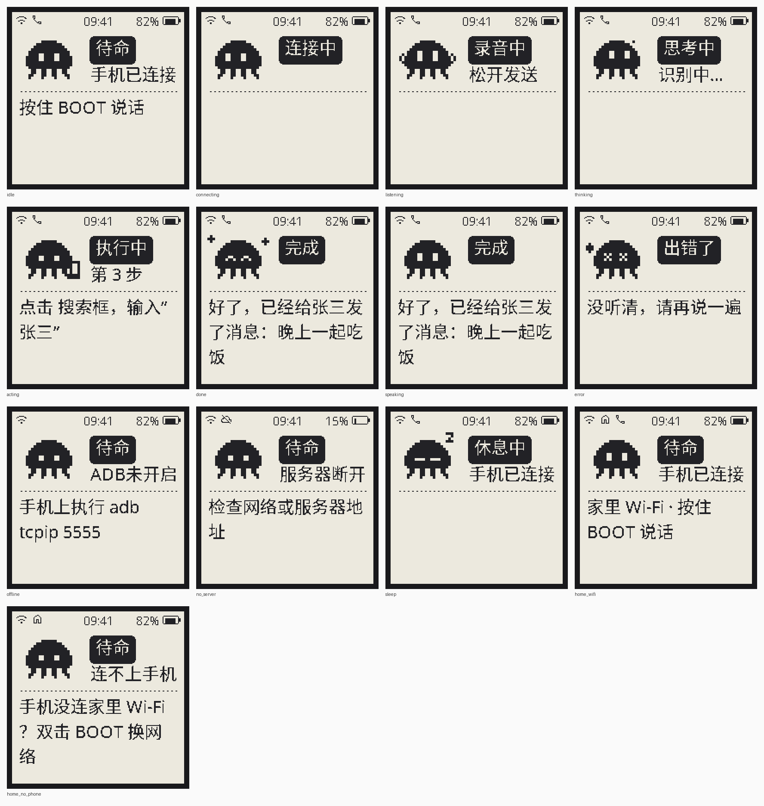
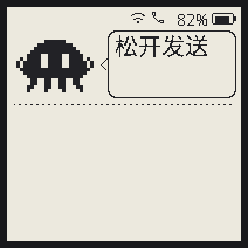
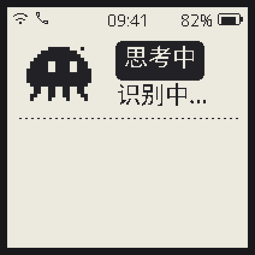
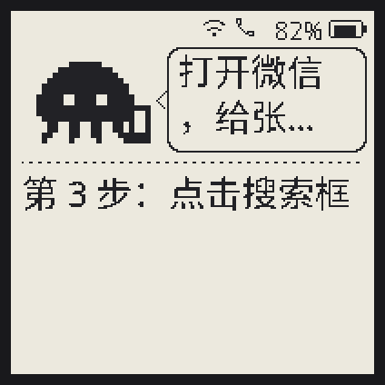
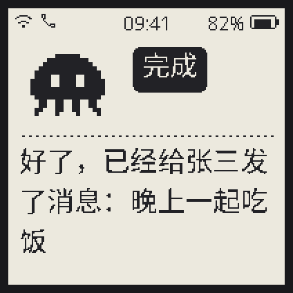
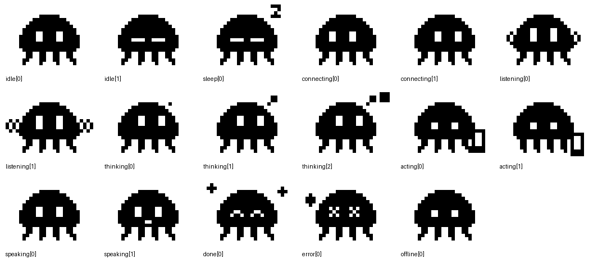

# E-paper UI

200×200 black/white e-paper. A pixel-art octopus mascot shows what the device is doing; the
state is a white-on-black label, details go below the dotted line.



| Listening | Thinking | Acting | Speaking |
|---|---|---|---|
|  |  |  |  |

All moods/frames: 

These images are **rendered by the real firmware UI code** (`shuttle_ui.cc`) on LVGL 9.5 with
the device fonts, converted to black/white with the same rule as the e-paper driver — so they
are what the panel shows (modulo e-paper contrast/ghosting).

## Where things live

| File | Role |
|---|---|
| `firmware/main/boards/shuttle/epaper-1.54-v2/shuttle_ui.{h,cc}` | UI layout + mascot animation (pure LVGL, runs on device and desktop) |
| `firmware/main/boards/shuttle/epaper-1.54-v2/shuttle_display.{h,cc}` | maps xiaozhi states / server `shuttle` messages / ADB link to the UI; e-paper refresh policy |
| `firmware/main/boards/shuttle/epaper-1.54-v2/mascot_frames.h` | generated mascot bitmaps (LVGL 1-bit images) |
| `tools/mascot/gen_mascot.py` | the mascot pixel art (edit here, re-run) |
| `tools/ui_sim/run.sh` | desktop renderer → `docs/ui/*.png|gif` (also runs in CI: artifact `ui-preview`) |

## States

| Mood | When | Animation |
|---|---|---|
| 待命 (idle) | ready, phone connected | blinks every 90 s; becomes 休息中 (sleep) after 10 min |
| 待命 (offline mascot) | phone / server link down — subtitle says why (ADB未开启, 连不上手机, 请手机授权, 服务器断开…), message says what to do | static |
| 连接中 | voice channel opening, boot steps | eyes look around |
| 录音中 | BOOT held | sound waves |
| 思考中 | ASR / agent planning (server `status thinking`) | thought bubbles |
| 执行中 | agent acting on the phone (`status acting`), subtitle 第 N 步 | tentacles + phone |
| 完成 / 播报中 | result (`status done`) / TTS playing | happy / mouth |
| 出错了 | errors | X eyes, sweat drop |

E-paper friendly by design: 1-bit art (no grey dithering), slow frames (0.6–1 s), animations
stop after 2 min, labels only redraw when their text changes, the ghost-clearing full refresh
never runs mid-animation.

## Changing it

```bash
$EDITOR tools/mascot/gen_mascot.py        # pixel art: 26×20 grid, scaled ×3
$EDITOR firmware/main/boards/shuttle/epaper-1.54-v2/shuttle_ui.cc   # layout
tools/ui_sim/run.sh                       # re-render previews (needs a C/C++ compiler, Pillow)
```
Then build/flash the firmware as usual. Keep text short: the title pill and subtitle fit ~5
Chinese characters, the message area 3 lines of ~9.
